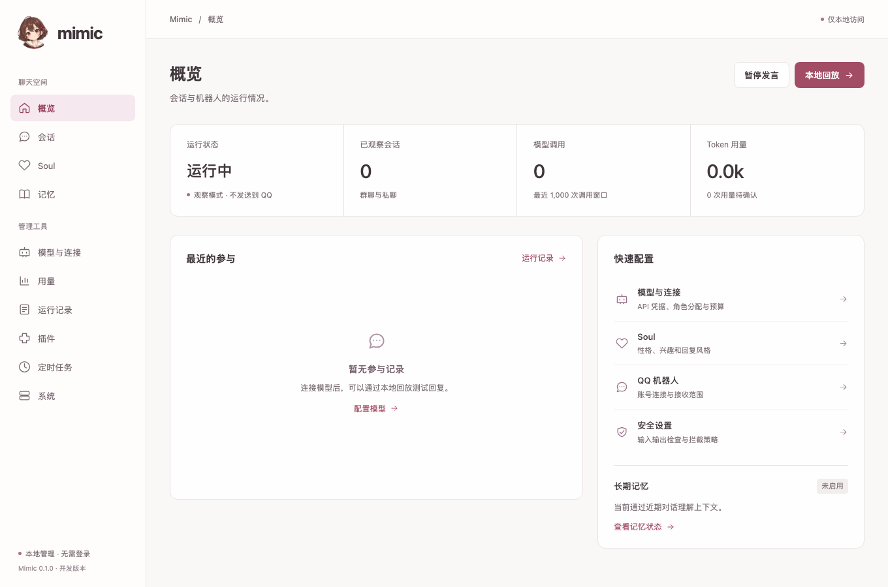
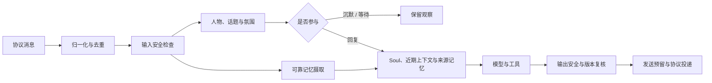

<div align="center">
  
  <h1>mimic</h1>
  <p><strong>知道什么时候接话，也知道什么时候保持安静。</strong></p>
  <p>一个关注人物、语境与群聊氛围的 TypeScript 聊天框架。</p>
  <p>
    <a href="https://github.com/backrunner/mimic/actions/workflows/ci.yml"></a>
    <a href="LICENSE"></a>
    
  </p>
  <p><a href="#快速开始">快速开始</a> · <a href="docs/getting-started.md">配置指南</a> · <a href="docs/plugins.md">插件开发</a> · <a href="docs/memstation.md">长期记忆</a> · <a href="CONTRIBUTING.md">参与贡献</a></p>
</div>



群聊里，一句合适的回复需要知道谁在和谁说话、问题是否已经解决、话题有没有转向，以及此刻是否值得插话。Mimic 把这些判断放在生成回复之前，再用 Soul、近期对话与有来源的记忆组织一两句自然的回应。

认真讨论时认真说，轻松聊天时可以接梗；不确定指代就澄清，没有贡献就沉默。这些是框架的行为约束，实际效果仍需要结合模型和真实群聊做校准。

> 当前为开发版。首次启动使用观察模式，QQ 和模型尚未配置，不会自动向群里发消息或调用付费服务。真实账号权限、群聊效果与生产容量仍需部署者验证。

## 能做什么

|                          |                                                                                                                                      |
| ------------------------ | ------------------------------------------------------------------------------------------------------------------------------------ |
| **读上下文，再决定参与** | 独立判断兴趣、贡献、打断风险、指代、话题和语气；支持沉默、等待和回复。主动插话有覆盖范围、概率、授权与冷却约束。                     |
| **用 Soul 定义相处方式** | 配置名字、兴趣、表达习惯和边界；近期语气优先于历史群风格。支持自己的 `soul.md`。                                                     |
| **记住有来源的内容**     | 可选 MemStation 插件，摄取不依赖机器人回复；区分接收与索引水位，支持来源复核、修改、撤回和带范围的查询。配置接入后自动开启。         |
| **一套模型连接**         | 文本、决策、Safety、搜索和记忆处理共用凭据、角色路由、预算与用量账本。支持 DeepSeek、TypeSafe/Jev、OpenAI Decisions 和本地兼容服务。 |
| **工具与行为插件**       | DeepSeek Search/Fetch、批准的表情素材、隔离 Node.js 计算、hooks、cron 和随机间隔任务；所有对外发言回到核心发送流水线。               |
| **本地管理面板**         | SvelteKit + Bits UI，管理模型、Soul、会话、日志、记忆、用量和任务；插件可提供自己的管理页面。                                        |

目前提供 QQ 官方机器人适配。协议、模型、记忆、工具、安全、存储与行为都通过抽象接口接入，OneBot 等协议可以另写插件。

## 快速开始

需要 **Node.js 24.21+** 和 **pnpm 12.3.4**。可用 `npm install -g pnpm@12.3.4` 安装项目使用的 pnpm 版本。

```sh
git clone https://github.com/backrunner/mimic.git
cd mimic
pnpm install --frozen-lockfile
pnpm build
pnpm start
```

打开 **[127.0.0.1:3210](http://127.0.0.1:3210)**，依次配置：

1. **模型与连接**：保存 API Key，为聊天、参与判断、群风格和安全选择角色路由。
2. **Soul**：写下它喜欢什么、不了解什么、怎样和别人说话。可从 [示例](examples/soul.md) 开始。
3. **会话**：先做本地回放，再看运行记录、最终草稿和用量。回放不发到 QQ；已配置的模型请求仍会计费。
4. **QQ 机器人**：配置 App ID、Client Secret 和 HTTPS Webhook，确认账号权限后切换实时模式。
5. **记忆**（可选）：配置 MemStation 的业务凭据与会话绑定，保存后自动开启；后续可手动暂停。

DeepSeek 可以先承担文本和 JSON 决策桥接。无原生概率的决策保持保守，不开放未经邀请的主动插话；原生决策、本地 embedding/rerank 及记忆 broker 的配置见 [配置指南](docs/getting-started.md) 和 [记忆接入](docs/memstation.md)。

## 部署

### Apple Container · 本地开发

在已安装并启动 Apple Container 的 macOS 上：

```sh
pnpm container:dev
# http://127.0.0.1:3210
pnpm container:down
```

脚本构建开发镜像，使用 `mimic-dev-data` 持久卷，并准备独立的代码沙箱 broker。停机保留数据。

### Docker Compose

```sh
docker compose up -d --build
docker compose logs -f mimic
docker compose down
```

两种方式均默认绑定本机端口。管理面板没有登录，保留在可信本机；QQ 公网反向代理只转发 Webhook 入口。代码工具使用独立的一次性容器，不挂载宿主容器 socket。[部署与沙箱说明 →](docs/deployment.md)

## 它怎样处理一条消息



发送前重新检查会话版本、配置、权限和记忆来源。网络投递结果未知时保留 `unknown`，不自动重发；未报告的模型用量也不会被当作零。

[架构与源码目录 →](docs/architecture.md)

## 开发与文档

```sh
pnpm check       # 类型与 Svelte 检查
pnpm test        # 单元与集成测试，使用确定性模型替身
pnpm build       # daemon + Dashboard
pnpm test:e2e    # 安装 Chromium 后运行浏览器测试
pnpm replay      # 检查回放场景材料，不调用模型
```

开发时分别运行 `pnpm dev` 和 `pnpm dev:dashboard`。完整校验、提交规范和可选的跨项目测试见 [贡献指南](CONTRIBUTING.md)。

| 文档                                  | 内容                                    |
| ------------------------------------- | --------------------------------------- |
| [配置指南](docs/getting-started.md)   | 模型角色、Soul、QQ 权限与首次运行       |
| [部署与沙箱](docs/deployment.md)      | Apple Container、Docker、端口与隔离工具 |
| [架构](docs/architecture.md)          | 运行边界、流水线与源码结构              |
| [插件开发](docs/plugins.md)           | 注册接口、作用域服务、管理页面与示例    |
| [MemStation 接入](docs/memstation.md) | 会话绑定、AI broker、来源与恢复         |
| [数据维护](docs/operations.md)        | SQLite、备份、密钥、保留期与恢复        |
| [安全政策](SECURITY.md)               | 部署边界与私密漏洞报告                  |

## 当前边界

目前面向单实例自托管。OneBot、多模态语义理解、隔离的第三方插件宿主和多副本协调尚未实现。近期上下文限 60 条 / 24,000 字符；主动参与阈值需要按实际群校准。自动化测试验证协议、状态和隔离约束，不代表真实模型的拟人程度或召回质量。

MemStation 是独立服务，可选接入；使用 [backrunner/memstation](https://github.com/backrunner/memstation) 的独立记忆契约。Mimic 不内嵌或重新许可该服务。模型厂商和 QQ 的账号、服务条款及调用费用由使用者自行配置。

## License

Mimic 的项目代码与文档采用 [Apache-2.0](LICENSE)。第三方组件保留各自许可，见 [第三方声明](THIRD_PARTY_NOTICES.md)。角色图标的生成来源与资源说明见 [assets/brand](assets/brand/README.md)。
